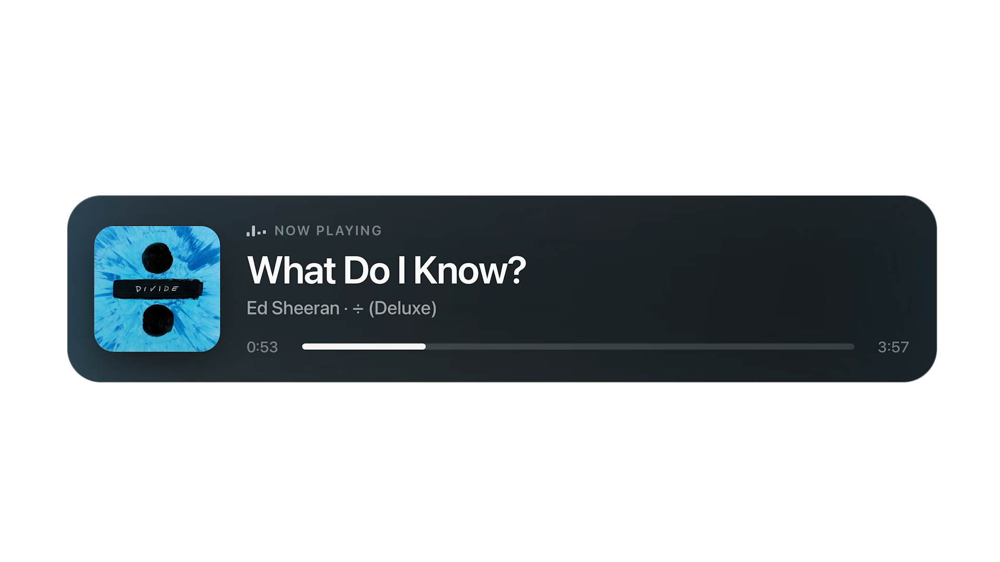

<div align="center">

# OBS Apple Music Progress Bar

**Apple Music / now-playing メディアセッション** で再生中の曲を、ジャケット画像と
リアルタイムの再生バー付きで OBS に表示する、軽量で透過なオーバーレイです。


[English](README.md) · **日本語**



</div>

---

> **Windows ユーザーの方へ:** Python は不要です。
> [**最新リリース**](https://github.com/m-shintaro/apple-music-obs-overlay/releases/latest)
> からポータブル ZIP をダウンロードし、実行ファイルをダブルクリックするだけで動きます。
> 詳しくは [Windows ポータブル ZIP](#windows-ポータブル-zippython-不要) を参照してください。

## 概要

小さな Python バックエンドが、有効なプロバイダーから現在のトラック情報（曲名・
アーティスト・アルバム・再生位置・総時間・ジャケット画像）を取得し、
`runtime/nowplaying.json` に書き出します。同梱の `overlay.html` がそのプラット
フォーム非依存のファイルを読み込み、OBS の **Browser Source** にそのまま追加できる
透過オーバーレイとして描画します。

macOS は任意の追加ツール `media-control` 経由で、OSの「再生中」情報を取得します。
ブラウザが再生情報を公開していれば、YouTubeなども表示できます。
追加ツールがない場合は、標準コマンドの `osascript` と `sips` 経由で Music.app を使用します。
Windows はオプションの Python extra 経由で OS のメディアセッション API（SMTC）を使用します。

## Features

- macOS のシステム再生情報（YouTubeを含む）、Music / Apple Music、Windows メディアセッションのリアルタイム表示
- OBS Browser Source 用の完全な透過オーバーレイ
- 経過時間と総時間を表示するリアルタイム再生バー
- macOSの「再生中」、Music.app、Windows SMTC から画像を取得し、対応する音楽ソースでは iTunes Search API にフォールバック
- 1080p / 4K 向けの表示倍率プリセットを内蔵
- 再生していなくてもレイアウトを確認できるデモモード

## Requirements

- Music.app / Apple Music または `media-control` を備えた macOS、または Apple Music for Windows を備えた Windows 10/11
- Python 3.9 以降 _(Windows ポータブル ZIP では不要)_
- OBS Studio

> 通常の静止ジャケットを追加のJPEG圧縮なしで最大640pxに縮小するため Pillow を使用します。Windows では
> `winsdk` をインストールする `windows` extra も必要です。ポータブル ZIP には同梱されています。
> Pillow が無い場合もクローンからそのまま起動でき、ジャケットは元のサイズのまま配信されます。

## Quick Start

リポジトリをクローンし、ローカルサーバーを起動します。

```bash
git clone https://github.com/m-shintaro/apple-music-obs-overlay.git
cd apple-music-obs-overlay
python3 -m pip install .
python3 nowplaying.py
```

次に OBS で **Browser Source** を追加し、URL に以下を指定します。

```text
http://localhost:8765/overlay.html
```

推奨ソースサイズ:

| 解像度 | 最小サイズ   |
| ------ | ------------ |
| 1080p  | `896 × 300`  |
| 4K     | `1792 × 600` |

カードの周囲は透過です。OBS 側のソースサイズは推奨より大きくしても問題ありません。

### macOSでYouTubeなどを表示する

Homebrewで [media-control](https://github.com/ungive/media-control) をインストールし、サーバーを再起動します。

```bash
brew install media-control
python3 nowplaying.py
```

既定の `auto` は追加ツールを検出し、macOSのコントロールセンターの **「再生中」** に
表示されるアプリを追従します。ブラウザでYouTubeを再生すると、動画タイトル・投稿者・
サムネイル・再生位置を表示します。ブラウザがOSに再生情報を公開する必要があります。
Chromeでの取得を確認済みです。他のブラウザやアプリも同じシステム情報を公開していれば
取得できます。ライブ配信などで総時間が不明な場合は `0:00` と空の再生バーを表示します。

再生・一時停止・シーク・OSから報告される再生速度に対応します。
再生情報は1本の常駐プロセスで受け取り、画像は必要なときに別途取得します。
ブラウザ動画では無関係なジャケットを表示しないよう、iTunes検索を使いません。
サムネイルが取得できない場合はプレースホルダーを表示します。

システム再生情報を明示的に指定する場合は `--provider macos-media`、Apple Musicだけを
取得する場合は `--provider macos` を使います。追加ツールがない環境の `auto` は従来どおり
Apple Musicを使用し、インストール方法を表示します。Homebrewの `/opt/homebrew` と
`/usr/local` はPATHに含まれていなくても検出します。

`media-control` 0.7.7で動作確認しています。追加ツールはAppleの非公開MediaRemote APIを
使用するため、将来のmacOS更新ではツールの更新が必要になる可能性があります。
取得プロセスが終了した場合や不正なデータを返した場合は、古い再生情報を継続せずエラーを
記録します。ツールを修復・更新してからサーバーを再起動してください。OS側の取得状況は
以下で確認できます。

```bash
media-control get --micros --no-artwork
```

### Windows セットアップ

Python をインストールしたくない場合は、下の
[Windows ポータブル ZIP](#windows-ポータブル-zippython-不要) に進んでください。

それ以外の場合は、リポジトリのディレクトリで、オプションの Windows 依存を一度
インストールします。

```powershell
py -3 -m pip install ".[windows]"
```

その後、同じローカルサーバーを起動します。

```powershell
py -3 nowplaying.py
```

OBS の Browser Source URL は両プラットフォームで共通です。

```text
http://localhost:8765/overlay.html
```

### Windows ポータブル ZIP（Python 不要）

Windows では Python のインストールは不要です。最新リリースからポータブルビルドを
ダウンロードしてください。

1. [**Releases** ページ](https://github.com/m-shintaro/apple-music-obs-overlay/releases/latest) を開きます。
2. **Assets** から `OBSAppleMusicProgressBar-<version>-windows-<arch>.zip` をダウンロードします。
3. ZIP を任意の場所に展開し、`OBSAppleMusicProgressBar.exe` をダブルクリックします。

コンソールウィンドウに OBS の Browser Source URL が表示されます。

```text
http://localhost:8765/overlay.html
```

ポータブルビルドは、実行ファイルと同じ場所に `runtime/` フォルダを書き出します。

<details>
<summary>ポータブル ZIP を自分でビルドする</summary>

Windows 上でローカルにポータブル ZIP をビルドする場合:

```powershell
powershell -NoProfile -ExecutionPolicy Bypass -File .\scripts\build-windows.ps1
```

ZIP は `dist/OBSAppleMusicProgressBar-<version>-windows-<arch>.zip` に出力されます。

</details>

## Usage

### 4K と倍率の調整

4K 配信では URL に `?profile=4k` を付けます。

```text
http://localhost:8765/overlay.html?profile=4k
```

任意の倍率を指定したい場合は `scale` を使います。

```text
http://localhost:8765/overlay.html?scale=1.75
```

### 再生なしでのプレビュー

メディアプロバイダーに依存せずレイアウトだけ確認する場合:

```bash
python3 nowplaying.py --demo
```

`runtime/` に 1 回だけファイルを書き出して終了する場合:

```bash
python3 nowplaying.py --once
```

### コマンドラインオプション

| Option                 | Default     | Description                                         |
| ---------------------- | ----------- | --------------------------------------------------- |
| `--provider`           | `auto`      | プロバイダー: `auto` / `macos`（Music専用）/ `macos-media`（システム再生情報）/ `windows` / `demo` |
| `--port`               | `8765`      | HTTP サーバーのポート                               |
| `--bind`               | `127.0.0.1` | HTTP サーバーの bind アドレス                       |
| `--interval`           | `0.25`      | プロバイダーの取得間隔（秒）                        |
| `--country`            | `JP`        | iTunes Search API の国コード                        |
| `--no-network-artwork` | off         | iTunes Search API によるジャケット取得を無効化      |
| `--demo`               | off         | `--provider demo` のエイリアス                      |
| `--once`               | off         | ファイルを 1 回だけ書き出して終了                   |
| `--diagnose-artwork`   | off         | プロバイダーのジャケット取得を診断                  |

## macOS Permissions

`--provider macos` の初回実行時に、Terminal または Python が Music.app を制御する許可を求められることがあります。

誤って許可しなかった場合は、**システム設定 → プライバシーとセキュリティ → オートメーション**
で Terminal / Python から Music を制御できるように設定してください。

## Artwork

ジャケット画像は次の順で解決されます。

1. **プロバイダーの画像** — macOSでは「再生中」の画像取得または Music.app からの直接書き出し、Windows では
   SMTC のサムネイルデータを使用します。
2. **iTunes Search API フォールバック** — `artist + title` で検索します。プロバイダーの
   取得に失敗した場合のみ使用されます。`macos-media` ではApple Musicだけが対象で、ブラウザ動画や他アプリには使用しません。

`runtime/nowplaying.json` には `artworkSource` と `artworkError` が含まれます。
`artworkSource: "mediaremote"` はmacOSのシステム画像、`artworkSource: "music"` は Music.app の直接取得、`artworkSource: "smtc"` は
Windows の SMTC サムネイルデータを使用、`artworkSource: "itunes"` はフォールバックを
使用したことを意味します。

ジャケット取得の診断:

```bash
python3 nowplaying.py --diagnose-artwork
```

ネットワークフォールバックを完全に無効化:

```bash
python3 nowplaying.py --no-network-artwork
```

ジャケット取得は同時1件で実行し、取得中も曲情報を更新します。画像のバージョンには
縮小後の内容ハッシュを使い、同じジャケットは再利用します。色プロファイルと透明度を保持し、アニメーション画像と16bitグレースケールPNGは元データをそのまま使用します。

## Generated Files

実行中、以下のファイルが `runtime/` に生成されます。

| File                 | Description                                      |
| -------------------- | ------------------------------------------------ |
| `nowplaying.json`    | Browser Source が読み込む曲情報                  |
| `nowplaying.txt`     | OBS Text Source でも使える簡易テキスト出力       |
| `cover_<sha256>.*` | 最大640pxの静止画（元JPEGまたは可逆PNG）、または元のアニメーション・高ビット深度画像。内容ハッシュで命名し、直近8枚まで保持 |
| `cover_direct.*`, `cover_media.*`, `cover_windows.*` | `--diagnose-artwork` 実行時のみ出力する元画像 |

> `runtime/` 配下の生成物はすべて `.gitignore` で除外されます。

JSON スキーマは [`docs/nowplaying-json.md`](docs/nowplaying-json.md) に記載されています。

## Troubleshooting

<details>
<summary><strong>OBS に何も表示されない</strong></summary>

- Music.app が起動しているか確認してください。
- 再生が停止している間はオーバーレイは更新されません。
- Browser Source の URL が `http://localhost:8765/overlay.html` か確認してください。
- `python3 nowplaying.py --demo` でデモ表示が出るか確認してください。
- Windows では `py -3 -m pip install ".[windows]"` を実行済み（またはポータブル EXE を起動済み）で、Apple Music がメディアセッションを公開しているか確認してください。

</details>

<details>
<summary><strong>ジャケット画像が表示されない</strong></summary>

- `python3 nowplaying.py --diagnose-artwork` でプロバイダーのジャケット取得の診断結果を確認してください。
- iTunes Search API のフォールバックにはネットワーク接続が必要です。
- ネットワーク送信を避けたい場合は `--no-network-artwork` を使ってください。

</details>

<details>
<summary><strong>ポートが使用中</strong></summary>

別のポートで起動してください。

```bash
python3 nowplaying.py --port 8766
```

OBS 側の URL も同じポートに変更します。

```text
http://localhost:8766/overlay.html
```

</details>

## Privacy

このツールは、macOSでは「再生中」またはローカルの Music.app から、Windows ではシステムのメディア
セッション API から再生情報を取得し、ローカルの `runtime/` ディレクトリに保存します。

デフォルトでは、プロバイダーからのジャケット取得に失敗した場合のみ、曲名とアーティスト名を
iTunes Search API に送信してフォールバック画像を検索します。この動作を無効にするには
`--no-network-artwork` を指定してください。`macos-media` ではブラウザやApple Music以外の
アプリの情報をiTunesへ送信しません。

## Contributing

Issue や Pull Request を歓迎します。バグ報告の際は、OS のバージョン、OBS のバージョン、
プロバイダー（`auto` / `macos` / `macos-media` / `windows` / `demo`）、
`python3 nowplaying.py --diagnose-artwork` の出力を添えていただけると助かります。

## License

本プロジェクトは MIT License で公開されています。詳細は [LICENSE](LICENSE) を参照してください。

## Credits

- **Creator** — shin ([GitHub: @m-shintaro](https://github.com/m-shintaro), [X: @xyzmiku](https://x.com/xyzmiku))
- [OBS Studio](https://obsproject.com/) — 配信ソフトウェアと Browser Source の実行環境
- Apple Music / Music.app — macOS 上の再生情報の取得元
- [media-control](https://github.com/ungive/media-control) — macOSシステム再生情報と画像の取得（別途インストール）
- Windows Media Control / SMTC — Windows 上の再生情報の取得元
- [iTunes Search API](https://developer.apple.com/library/archive/documentation/AudioVideo/Conceptual/iTuneSearchAPI/) — ジャケット画像のフォールバック検索

---

> **Disclaimer** — このプロジェクトは Apple Inc. または OBS Project による公式
> プロジェクトではありません。Apple、Apple Music、iTunes、macOS は Apple Inc. の
> 商標です。OBS および OBS Studio は OBS Project の名称です。楽曲情報やジャケット
> 画像の権利は各権利者に帰属します。
