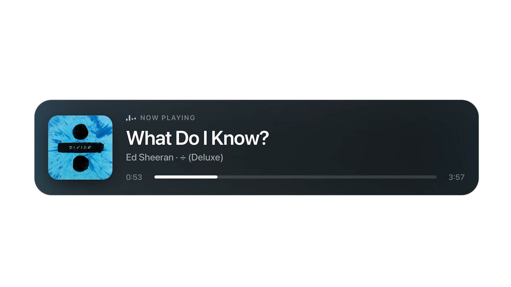

<div align="center">

# OBS Apple Music Progress Bar

A lightweight, transparent OBS overlay that shows the track currently playing in
**Apple Music / now-playing media sessions** — complete with album artwork and a live progress bar.


**English** · [日本語](README.ja.md)



</div>

---

> **Windows users:** no Python required — just grab the portable ZIP from the
> [**latest release**](https://github.com/m-shintaro/apple-music-obs-overlay/releases/latest)
> and double-click the executable. See [Windows portable ZIP](#windows-portable-zip-no-python-required).

## Overview

A small Python backend polls the active provider for the current track — title,
artist, album, playback position, duration, and artwork — and writes it to
`runtime/nowplaying.json`. The bundled `overlay.html` reads that platform-neutral
file and renders a clean, transparent overlay you can drop straight into an OBS
**Browser Source**.

macOS reads system Now Playing information through the optional `media-control`
helper, including YouTube in browsers that publish media metadata to macOS.
Without the helper it uses Music.app through the built-in `osascript` and `sips` commands.
Windows uses the OS media session API (SMTC) through an optional Python extra.

## Features

- Live "now playing" display for macOS system media (including YouTube), Music / Apple Music, and Windows media sessions
- Fully transparent overlay, ready for an OBS Browser Source
- Real-time progress bar with elapsed and total time
- Artwork from macOS Now Playing, Music.app or Windows SMTC; iTunes Search fallback for supported music sources
- Built-in scaling presets for 1080p and 4K layouts
- Demo mode for previewing the layout without playing anything

## Requirements

- macOS with Music.app / Apple Music or `media-control`, or Windows 10/11 with Apple Music for Windows
- Python 3.9 or later _(not needed for the Windows portable ZIP)_
- OBS Studio

> Pillow resizes ordinary static artwork to at most 640px without added JPEG compression. Windows support also
> requires the optional `windows` extra, which installs `winsdk`. Both are bundled in the portable ZIP.
> Without Pillow the overlay still runs from a clone; artwork is then served at its original size.

## Quick Start

Clone the repository and start the local server:

```bash
git clone https://github.com/m-shintaro/apple-music-obs-overlay.git
cd apple-music-obs-overlay
python3 -m pip install .
python3 nowplaying.py
```

Then, in OBS, add a **Browser Source** and point it at:

```text
http://localhost:8765/overlay.html
```

Recommended source size:

| Resolution | Minimum size |
| ---------- | ------------ |
| 1080p      | `896 × 300`  |
| 4K         | `1792 × 600` |

The area around the card is transparent, so a larger OBS source size is perfectly fine.

### macOS: system Now Playing content

Install [media-control](https://github.com/ungive/media-control) with Homebrew, then restart the server:

```bash
brew install media-control
python3 nowplaying.py
```

The default `auto` provider detects the helper and follows the app shown in macOS
Control Center's **Now Playing** panel. Play a YouTube video in your browser to
display its title, channel, thumbnail and playback progress. The browser must
publish that information to macOS; Chrome has been verified locally. Other apps
and browsers work when they publish the same system metadata. Unknown live-stream
duration is shown as `0:00` with an empty progress bar.

Playback, pause, seeking and reported playback speed are supported. One persistent
metadata stream is used, with artwork fetched separately when needed and rechecked
every five seconds to catch image-only updates. Browser
videos do not use the iTunes artwork fallback, which could find an unrelated cover.
Missing thumbnails use the overlay's placeholder.

To require system media explicitly, use `--provider macos-media`. To follow only
Apple Music, use `--provider macos`. Without `media-control`, `auto` retains the
Apple Music provider and prints the installation command. Homebrew installations
in `/opt/homebrew` and `/usr/local` are detected even outside a terminal's PATH.

Tested with `media-control` 0.7.7. The helper uses Apple's private MediaRemote API;
future macOS changes may require a helper update. `auto` runs `media-control test`
at startup and keeps the Apple Music provider if the helper is installed but not
functional. If the stream exits or reports invalid data, the backend reports an
error instead of showing stale playback and restarts the stream automatically
(after 1 second, doubling up to 30 seconds while it keeps failing). To check what
macOS reports:

```bash
media-control get --micros --no-artwork
```

### Windows setup

Prefer not to install Python? Skip to the
[Windows portable ZIP](#windows-portable-zip-no-python-required) below.

Otherwise, from the repository directory, install the optional Windows dependency once:

```powershell
py -3 -m pip install ".[windows]"
```

Then start the same local server:

```powershell
py -3 nowplaying.py
```

The OBS Browser Source URL is the same on both platforms:

```text
http://localhost:8765/overlay.html
```

### Windows portable ZIP (no Python required)

You don't need to install Python on Windows — download the portable build from the
latest release:

1. Open the [**Releases** page](https://github.com/m-shintaro/apple-music-obs-overlay/releases/latest).
2. Under **Assets**, download `OBSAppleMusicProgressBar-<version>-windows-<arch>.zip`.
3. Extract the ZIP anywhere, then double-click `OBSAppleMusicProgressBar.exe`.

The console window prints the OBS Browser Source URL:

```text
http://localhost:8765/overlay.html
```

The portable build writes its `runtime/` folder next to the executable.

<details>
<summary>Building the portable ZIP yourself</summary>

To build the portable ZIP locally on Windows:

```powershell
powershell -NoProfile -ExecutionPolicy Bypass -File .\scripts\build-windows.ps1
```

The ZIP is written to `dist/OBSAppleMusicProgressBar-<version>-windows-<arch>.zip`.

</details>

## Usage

### 4K and custom scaling

For 4K streams, append `?profile=4k` to the URL:

```text
http://localhost:8765/overlay.html?profile=4k
```

Or set any custom scale factor:

```text
http://localhost:8765/overlay.html?scale=1.75
```

### Preview without playback

Preview the layout without relying on a media provider:

```bash
python3 nowplaying.py --demo
```

Write the files to `runtime/` once and exit:

```bash
python3 nowplaying.py --once
```

### Command-line options

| Option                 | Default     | Description                                     |
| ---------------------- | ----------- | ----------------------------------------------- |
| `--provider`           | `auto`      | Provider: `auto`, `macos` (Music only), `macos-media` (system media), `windows`, or `demo` |
| `--port`               | `8765`      | HTTP server port                                |
| `--bind`               | `127.0.0.1` | HTTP server bind address                        |
| `--interval`           | `0.25`      | Provider polling interval, in seconds           |
| `--country`            | `JP`        | iTunes Search API country code                  |
| `--no-network-artwork` | off         | Disable the iTunes Search API artwork fallback  |
| `--demo`               | off         | Alias for `--provider demo`                     |
| `--once`               | off         | Write files once and exit                       |
| `--diagnose-artwork`   | off         | Diagnose provider artwork export                |

## macOS Permissions

When using `--provider macos`, macOS may ask whether Terminal or Python is allowed to control Music.app.

If you accidentally denied it, re-enable access under
**System Settings → Privacy & Security → Automation** and allow Terminal / Python
to control Music.

## Artwork

Artwork is resolved in the following order:

1. **Provider artwork** — macOS Now Playing artwork, direct Music.app export, or SMTC thumbnail data on Windows.
2. **iTunes Search API fallback** — a lookup by `artist + title`, used only when
   provider artwork fails. With `macos-media`, this fallback is enabled only for Apple Music, not browser videos or other apps.

`runtime/nowplaying.json` includes `artworkSource` and `artworkError` fields.
`artworkSource: "music"` means the macOS direct export succeeded,
`artworkSource: "mediaremote"` means macOS system media artwork was used,
`artworkSource: "smtc"` means Windows SMTC thumbnail data was used, and
`artworkSource: "itunes"` means the fallback was used.

Diagnose artwork retrieval:

```bash
python3 nowplaying.py --diagnose-artwork
```

Disable the network fallback entirely:

```bash
python3 nowplaying.py --no-network-artwork
```

Artwork lookup runs one job at a time while track metadata continues updating.
Published artwork versions are hashes of the normalized image, so tracks sharing a
cover reuse the same image. Color profiles and transparency are preserved; animated covers and 16-bit grayscale PNGs retain their original data.

## Generated Files

While running, the tool writes the following files into `runtime/`:

| File                 | Description                                        |
| -------------------- | -------------------------------------------------- |
| `nowplaying.json`    | Track data consumed by the Browser Source          |
| `nowplaying.txt`     | Plain-text output, usable as an OBS Text Source    |
| `cover_<sha256>.*` | Up to 8 recent covers; static covers up to 640px (original JPEG or lossless PNG), or original animated/high-bit-depth covers |
| `cover_direct.*`, `cover_media.*`, `cover_windows.*` | Raw provider images written only by `--diagnose-artwork` |

> Everything under `runtime/` is ignored by `.gitignore`.

The JSON schema is documented in [`docs/nowplaying-json.md`](docs/nowplaying-json.md).

## Troubleshooting

<details>
<summary><strong>Nothing appears in OBS</strong></summary>

- Make sure Music.app is running.
- The overlay does not update while playback is stopped.
- Confirm the Browser Source URL is `http://localhost:8765/overlay.html`.
- Run `python3 nowplaying.py --demo` to verify the overlay layout.
- On Windows, confirm `py -3 -m pip install ".[windows]"` has been run (or that you launched the portable EXE) and Apple Music exposes a media session.

</details>

<details>
<summary><strong>Artwork does not appear</strong></summary>

- Run `python3 nowplaying.py --diagnose-artwork` to inspect provider artwork diagnostics.
- The iTunes Search API fallback requires network access.
- Use `--no-network-artwork` if you would rather not send track metadata over the network.

</details>

<details>
<summary><strong>The port is already in use</strong></summary>

Start the server on a different port:

```bash
python3 nowplaying.py --port 8766
```

Then update the OBS Browser Source URL to match:

```text
http://localhost:8766/overlay.html
```

</details>

## Privacy

This tool reads playback information from macOS Now Playing or local Music.app, or from
the Windows system media session API on Windows, then writes it to the local
`runtime/` directory.

By default, when provider artwork retrieval fails, the track title and artist are sent to
the iTunes Search API to look up fallback artwork. Pass `--no-network-artwork` to
disable this behavior. The `macos-media` provider never sends browser or other non-Music app metadata to iTunes.

## Contributing

Issues and pull requests are welcome. When reporting a bug, it helps to include your
OS version, OBS version, provider (`auto`, `macos`, `macos-media`, `windows`, or `demo`), and the
output of `python3 nowplaying.py --diagnose-artwork`.

## License

This project is released under the MIT License. See [LICENSE](LICENSE) for details.

## Credits

- **Creator** — shin ([GitHub: @m-shintaro](https://github.com/m-shintaro), [X: @xyzmiku](https://x.com/xyzmiku))
- [OBS Studio](https://obsproject.com/) — streaming software and Browser Source runtime
- Apple Music / Music.app — source of playback information on macOS
- [media-control](https://github.com/ungive/media-control) — macOS system Now Playing metadata and artwork (installed separately)
- Windows Media Control / SMTC — source of playback information on Windows
- [iTunes Search API](https://developer.apple.com/library/archive/documentation/AudioVideo/Conceptual/iTuneSearchAPI/) — fallback artwork lookup

---

> **Disclaimer** — This is not an official project by Apple Inc. or the OBS Project.
> Apple, Apple Music, iTunes, and macOS are trademarks of Apple Inc. OBS and OBS Studio
> are names of the OBS Project. Track metadata and artwork belong to their respective
> rights holders.
